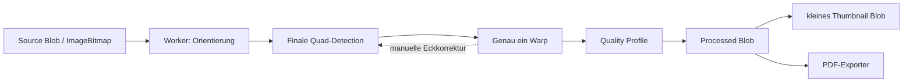
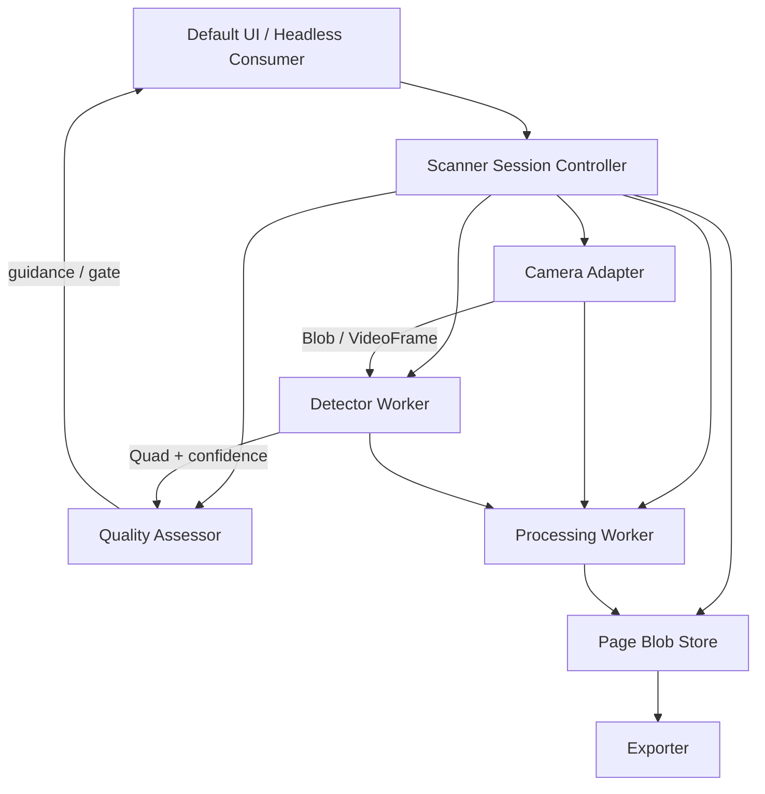

# Tiefenanalyse: Scanqualität, Performance, Postprocessing und User Flow

Stand: 21. Juli 2026

Analysierter Stand: `30338a9` (`master`)

Paketversion: `0.6.0`

## 1. Kurzfazit

Die Qualitäts- und Performanceprobleme entstehen nicht durch einen einzelnen zu schwachen Filter. Die aktuelle Pipeline hat vier miteinander gekoppelte Engpässe:

1. Das DocAligner-Modell wird lokal nicht entsprechend seinem Referenzpfad vor- und nachverarbeitet. Die aktuelle Implementierung nutzt RGB plus Nearest-Neighbor und nimmt nur das Heatmap-Maximum. Der offizielle Pfad arbeitet faktisch mit BGR-Eingaben, bilinearem Resize sowie Threshold-, Komponenten- und Schwerpunktlogik.
2. Die geometrische Validierung verlangt im Kamerabild fast rechte Winkel und ähnlich lange gegenüberliegende Seiten. Das widerspricht gerade der Perspektive, die der Scanner korrigieren soll. Ein offizielles DocAligner-Beispielpolygon wird abgelehnt, ein winziges Quadrat dagegen akzeptiert.
3. Ein Foto wird als Kette mehrerer vollständiger `ImageData`-Kopien synchron auf dem Main Thread verarbeitet und anschließend mehrfach dauerhaft im Speicher gehalten. Höhere Auflösung würde dieses Problem quadratisch verschärfen.
4. Der User Flow bildet nur grob „nicht stabil“ und „stabil“ ab. Manuelles Auslösen ist bei unsicherer Erkennung gesperrt, Capture-Fehler können unsichtbar bleiben, und im Review fehlen die Werkzeuge, die unvermeidbare Erkennungsfehler auffangen müssten.

Die richtige Reihenfolge ist deshalb:

| Priorität | Massnahme | Erwarteter Effekt |
| --- | --- | --- |
| P0 | Referenzdatensatz und Messgrössen etablieren | Änderungen werden objektiv vergleichbar |
| P0 | Modellvertrag, Heatmap-Decoding und Quad-Validierung korrigieren | Deutlich weniger verpasste bzw. falsche Dokumente |
| P0 | Capture als expliziten, fehlertoleranten Zustandsablauf modellieren | Kein blockierter oder lautlos scheiternder Flow |
| P1 | Postprocessing in einen Worker verschieben und Seiten als Blobs statt dauerhafte RGBA-Kopien halten | Weniger UI-Stalls, Abstürze und Speicherverbrauch |
| P1 | Danach erst echte Still-Capture-Auflösung aktivieren und gerätespezifisch abstufen | Mehr Textdetails ohne unkontrollierten Memory-Peak |
| P1 | Qualitätsprofile und manuellen Crop-/Rotate-/Retake-Flow ergänzen | Bessere Resultate für Farbe, Schatten, Belege und schwierige Aufnahmen |
| P2 | Runtime-Assets versionieren/verkleinern und Scanner-Lifecycle härten | Schnellere Wiederaufnahme und robustere Upgrades |

**Zielbild:** Auto-Capture ist eine komfortable Optimierung, aber nie die einzige Möglichkeit, ein Dokument zu erfassen. Die Kamera liefert möglichst gute Rohdaten; Erkennung, Qualitätsbewertung und Postprocessing sind getrennte, messbare Stufen; das Review kann jeden automatischen Fehler korrigieren.

## 2. Umfang und Methode

Untersucht wurden:

- Nuxt-Modulkonfiguration und ausgelieferte Assets
- Kamera-Constraints, Stream-Lifecycle und Still-Capture-Pfade
- ONNX-Modellvertrag, Preprocessing, Inferenz und Heatmap-Decoding
- Quad-Validierung, Glättung, Stabilitäts- und Auto-Capture-Logik
- Perspektivkorrektur, Bildfilter, Thumbnail- und PDF-Erzeugung
- Komponentenfluss, Fehlersituationen, Review und Accessibility
- Tests, Produktions-Build, Paketgrösse und lokale Laufzeitpfade

Zusätzlich wurden folgende reproduzierbare Checks durchgeführt:

- `bun run test`: 6 Testdateien, 17 Tests erfolgreich
- `bun run lint`: erfolgreich
- `bun run test:types`: erfolgreich
- `bun run prepack`: erfolgreich
- `bun run dev:build`: erfolgreich
- Produktionsassets wurden roh und gzip-komprimiert vermessen
- Das ONNX-Modell wurde strukturell inspiziert und lokal inferiert
- Filterlaufzeiten und Speicherverhalten wurden mit synthetischen Bildern gemessen
- Der UI-Flow wurde lokal in Chromium mit verweigerter Berechtigung, Fake-Kamera und synthetischem Zwei-Seiten-Dokument geprüft

Nicht belastbar getestet wurden reale Smartphone-Optik, Autofokus, Bewegung, Glare, iOS-Safari-Speichergrenzen und die nativen Betriebssystem-Berechtigungsdialoge. Die Empfehlungen dafür sind code- und API-basiert und müssen in einer Realgeräte-Matrix verifiziert werden.

## 3. Ist-Pipeline

```mermaid
flowchart LR
  A["ONNX vollständig laden"] --> B["Kamera anfragen"]
  B --> C["Videoframe als RGBA lesen"]
  C --> D["Auf max. 512 px skalieren"]
  D --> E["Im Worker erneut auf 256×256 skalieren"]
  E --> F["4 Heatmap-Maxima"]
  F --> G["Strenge Rechteckprüfung"]
  G --> H["Flächenbasierte Stabilität"]
  H --> I["Auto- oder manueller Capture"]
  I --> J["Mindestens 1050 ms Flash"]
  J --> K["Finalframe und erneute Detection"]
  K --> L["OpenCV lazy laden"]
  L --> M["Warp und Crop berechnen"]
  M --> N["Graustufe → Min/Max → Blur → Sharpen"]
  N --> O["Original + Processed + Full-res Data-URL halten"]
  O --> P["Alle Seiten als Base64-JPEG → PDF"]
```



Die Reihenfolge erzeugt drei wahrnehmbare Wartephasen: vor der Kamera, nach dem Auslösen und beim PDF-Export. Gleichzeitig werden Qualitätsentscheidungen an mehreren Stellen implizit getroffen, ohne sie dem Nutzer zu zeigen oder später korrigierbar zu machen.

## 4. Gemessene technische Baseline

### 4.1 Auslieferungsgrösse und Cold Start

`npm pack --dry-run --ignore-scripts --json` ergab:

| Grösse | Messwert |
| --- | ---: |
| npm-Tarball | 28,123,079 Bytes |
| Entpacktes Paket | 95,060,607 Bytes |
| Dateien im Paket | 90 |
| Runtime-Public-Assets roh | 94,866,913 Bytes / 90.47 MiB |

Relevante Einzelassets:

| Asset | Roh | gzip | Zeitpunkt |
| --- | ---: | ---: | --- |
| DocAligner ONNX-Modell | 4.77 MB | 4.37 MB | Scannerstart |
| OpenCV 4.8 JavaScript | 10.13 MB | 3.27 MB | erster erfolgreicher Capture |
| ONNX SIMD-WASM | 10.60 MB | 2.79 MB | Scannerstart |
| ONNX threaded SIMD-WASM | 10.68 MB | 2.81 MB | je nach Umgebung |
| Corner Worker | 145.5 KB | 48.3 KB | Scannerstart |
| initiales Client-JavaScript | 176.2 KB | ca. 66.0 KB | App-Start |
| dynamischer `pdf-lib`-Chunk | 527.6 KB | ca. 209.3 KB | PDF-Export |

Damit benötigt der erste Detector-Start grob **7.2 MB komprimierte Nutzlast** aus Modell, einem WASM-Binary und Worker. Beim ersten Capture kommen rund **3.3 MB komprimiertes OpenCV** hinzu. Browsercache, Protokoll-Overhead und Dekompression sind darin nicht enthalten.

Positiv ist, dass `pdf-lib` bereits code-gesplittet ist und nicht den initialen App-Start belastet. Problematisch ist, dass sechs ONNX-WASM-Varianten mit ausgeliefert werden und OpenCV sein WASM als Base64 in einem grossen JavaScript-Asset trägt.

### 4.2 Main-Thread- und Speicherbaseline

Die reine JavaScript-Filterkette wurde lokal in Bun ohne Canvas-Readback, OpenCV-Warp, JPEG-Encoding und Videopipeline gemessen:

| Bildgrösse | Pixel | Filterkette | beobachtete Prozess-RSS |
| --- | ---: | ---: | ---: |
| 1358×1920 | 2.61 MP | ca. 95 ms | ca. 128 MiB |
| 3024×4032 | 12.19 MP | ca. 374 ms | ca. 457 MiB |

Das ist eine Desktop-Untergrenze, keine mobile SLA. Auf einem älteren Smartphone kommen Canvas-Readback, OpenCV und Encoding hinzu; ausserdem blockiert der Code dort den UI-Thread.

Aus den gleichzeitig lebenden RGBA-/Float-Puffern ergibt sich für die heutige Kette ein temporärer Bedarf von bis zu ungefähr **48 Bytes pro Pixel**, noch ohne Canvas-, OpenCV-, JPEG-, Video- und Runtime-Speicher:

| Auflösung | Näherungswert nur Pixelpuffer |
| --- | ---: |
| 1280×905 | ca. 53 MiB |
| 1358×1920 | ca. 119 MiB |
| 1920×1080 | ca. 95 MiB |
| 3840×2160 | ca. 380 MiB |
| 4032×3024 | über 550 MiB |

Bereits bei 2.61 MP halten `original` und `processed` zusammen dauerhaft rund 20 MiB rohe RGBA-Daten pro Seite. Die als `thumbnail` bezeichnete Full-Resolution-JPEG-Data-URL und deren decodierte Browseroberflächen kommen zusätzlich hinzu.

### 4.3 Aktueller Auflösungsrahmen

High-Resolution-Capture ist standardmässig ausgeschaltet ([`src/module.ts:18-26`](../src/module.ts#L18-L26)). Der normale Capture übernimmt deshalb den aktuellen Videoframe ([`useDocumentScanner.ts:275-333`](../src/runtime/composables/useDocumentScanner.ts#L275-L333)).

Auf iOS wird die lange Kante auf 1280 Pixel begrenzt ([`useStream.ts:45-74`](../src/runtime/composables/useStream.ts#L45-L74)). Ein A4-Dokument erreicht damit vor dem Crop nur ungefähr 110 dpi. Zum Vergleich benötigt A4 für 200 dpi rund 2339 Pixel und für 300 dpi rund 3508 Pixel an der langen Kante. Für OCR, kleine Schrift und feine Linien ist der aktuelle Standard daher sichtbar limitiert.

Höhere Auflösung darf aber nicht isoliert aktiviert werden: Bei der aktuellen Speicherarchitektur würde sie das Absturzrisiko auf Mobilgeräten massiv erhöhen.

## 5. Aufnahme und Corner Detection

### 5.1 Der Modellvertrag wird nicht exakt eingehalten

Das ausgelieferte Modell hat lokal folgenden Vertrag:

- Eingang: Float-Tensor `img`, Shape `[1, 3, 256, 256]`
- Ausgang: vier Heatmaps, bei lokaler Inferenz `[1, 4, 128, 128]`
- Modell-SHA-256: `f4117b786e3a18470f3865c93f3c2bd69d9b998edd60f385574a5c665e79594e`

Aktuell skaliert der Worker jedes Bild manuell per Nearest-Neighbor, schreibt die Kanäle als RGB in CHW-Form und normalisiert auf 0–1 ([`corner.worker.ts:164-197`](../src/runtime/workers/corner.worker.ts#L164-L197)). Danach wird pro Heatmap lediglich das höchste einzelne Pixel zurückgegeben ([`corner.worker.ts:207-239`](../src/runtime/workers/corner.worker.ts#L207-L239)). Es gibt weder Mindestkonfidenz noch Komponentenbildung oder einen Zustand „Ecke fehlt“.

Der offizielle DocAligner-Pfad ist anders:

- Das Quickstart-Beispiel liest mit OpenCV ein und übergibt damit BGR-Daten an den Preprocessor.
- `preprocess` resized bilinear auf 256×256, transponiert nach CHW und normalisiert.
- Jede Heatmap wird auf die Bildgrösse skaliert, bei 0.3 thresholded und binarisiert.
- Aus der grössten gefundenen Komponente wird der Schwerpunkt bestimmt; fehlende Komponenten führen zu einer unvollständigen Erkennung.

Quellen: [DocAligner Quickstart](https://docsaid.org/en/docs/docaligner/quickstart/), [DocAligner Einführung und Eckreihenfolge](https://docsaid.org/en/docs/docaligner/intro/), [offizieller Inferenzcode auf dem analysierten Stand](https://github.com/DocsaidLab/DocAligner/blob/3275b0f07f8e99d8c01cb0774dea2549be1416b6/docaligner/heatmap_reg/infer.py), [Capybara-Resize-Implementierung](https://github.com/DocsaidLab/Capybara/blob/85a0d2638f895b39f82965b137320c8aa92c517b/capybara/vision/geometric.py).

Die BGR-Anforderung ist eine Schlussfolgerung aus dem vollständigen offiziellen Aufrufpfad, nicht aus ONNX-Metadaten. Sie sollte deshalb mit Golden Images festgeschrieben werden.

Eine lokale Reproduktion mit dem offiziellen 512-Pixel-Beispiel ergab:

| Variante | Eckfehler gegenüber dokumentierter Ausgabe |
| --- | ---: |
| aktuelles RGB + Nearest + Argmax | ungefähr 4–5 Pixel |
| BGR + bilinear + Threshold/Schwerpunkt | ungefähr 1 Pixel oder weniger |

Auf ein 1920-Pixel-Foto hochskaliert entspricht der aktuelle Fehler grob 15–19 Pixeln. Das ist nur ein Referenzbild, noch kein belastbarer Corpus-Benchmark, zeigt aber einen klaren Correctness-Fehler vor jeder Modellfrage.

**Empfehlung P0:**

1. BGR/RGB, Resize-Verfahren und Normalisierung als getesteten `ModelContract` kapseln.
2. Offizielles Heatmap-Decoding portieren: Threshold, grösste Komponente, gewichteter oder geometrischer Schwerpunkt und explizite Konfidenz.
3. Pro Ecke `point`, `peak`, `mass`, `componentArea` und Gesamtconfidence zurückgeben.
4. Bei einer fehlenden Ecke kein synthetisches Vierpunktpolygon erzeugen.
5. Erst nach dieser Korrektur alternative Modelle oder höhere Modellauflösung evaluieren.

### 5.2 Die Quad-Validierung bekämpft Perspektive statt Fehler

[`isValidRectangle`](../src/runtime/utils/overlay.ts#L172-L247) verlangt unter anderem:

- hohe Rechteckigkeit in der Bildfläche
- maximal 2.5:1 Seitenverhältnis
- mindestens 0.75 Ähnlichkeit gegenüberliegender Seiten
- maximal 25 Grad Abweichung jeder Ecke von 90 Grad

Ein schräg fotografiertes Blatt hat im Kamerabild jedoch gerade keine rechtwinklige Projektion. Lange Kassenbons überschreiten zudem leicht das feste Seitenverhältnis.

Reproduktion mit dem Beispielpolygon aus der DocAligner-Dokumentation:

```text
offizielles perspektivisches Polygon: valid = false, Fläche = 51778.87875
winziges 10×10-Quadrat:             valid = true,  Fläche = 100
```

Der Validator verwirft damit ein realistisches positives Beispiel, besitzt aber keine relative Mindestfläche oder Mindestseitenlänge gegen winzige False Positives.

**Empfehlung P0:** Quad-Gültigkeit als Projektionsgeometrie prüfen, nicht als frontales Rechteck:

- alle Werte endlich und innerhalb eines tolerierten Bildrandes
- genau vier normalisierte Punkte in Reihenfolge TL → TR → BR → BL
- konsistente Winding-Richtung, Konvexität und keine Selbstüberschneidung
- Mindestkantenlänge und relative Polygonfläche, zum Beispiel konfigurierbar pro Dokumenttyp
- kein nahezu kollineares Dreieck und keine singuläre Homographie
- plausible Perspektivverkürzung statt Gleichheit gegenüberliegender Seiten
- lange Belege als eigenes Profil statt globalem `maxAspectRatio = 2.5`
- Modellconfidence und Heatmapqualität in die Entscheidung einbeziehen

Die genauen Grenzwerte dürfen nicht geraten werden. Sie sind gegen einen gelabelten Datensatz so zu kalibrieren, dass False Rejects und False Auto-Captures getrennt sichtbar werden.

### 5.3 „Stabil“ misst fast nur konstante Fläche

Die aktuelle Stabilität verwendet die Varianz der Polygonfläche ([`useCornerDetection.ts:266-345`](../src/runtime/composables/useCornerDetection.ts#L266-L345)). Ein Polygon kann sich bei gleicher Fläche verschieben oder drehen und trotzdem stabil wirken. Umgekehrt können kleine Heatmap-Schwankungen die Fläche verändern, obwohl die Kamera ruhig steht.

Zwei Lifecycle-Fehler verschärfen das:

- Bei ungültigen Frames wird `stableStartTime` nicht vollständig zurückgesetzt. Nach einer Unterbrechung kann eine neue Erkennung zu früh als stabil gelten.
- Der Miss-Timer wird nicht in jedem gültigen Pfad zuverlässig zurückgesetzt, was zu verzögertem Verschwinden oder Flackern führen kann.

Die Standardwerte sind sehr permissiv: `stableMotionThreshold` und `stableSignificantMotionThreshold` stehen beide auf `0.3`, während `stableDuration` 1800 ms beträgt ([`src/module.ts:39-49`](../src/module.ts#L39-L49)). Zusammen mit dem Auto-Capture-Delay von 1400 ms dauert der ideale automatische Ablauf mindestens ungefähr 3.2 Sekunden.

**Empfehlung P0:** Stabilität aus mehreren normierten Merkmalen ableiten:

- RMS-Bewegung aller vier Ecken relativ zur Bilddiagonale
- Polygon-IoU zum vorherigen geglätteten Quad
- Geschwindigkeit und Beschleunigung der Ecken
- kontinuierliche statt kumulierte stabile Zeit
- Detection-Confidence und vollständiges Quad
- optional Gyroskop nur als zusätzlicher Hinweis, nicht als Voraussetzung

Alle History-, Miss-, Stable- und Cooldown-Timer müssen bei Sessionwechsel, ungültigem Frame und Generationwechsel atomar zurückgesetzt werden.

### 5.4 Live-Detection kopiert und skaliert unnötig

Der aktuelle Pfad:

1. liest einen Videoframe als RGBA `ImageData`,
2. hält dafür einen Full-Resolution-Canvas,
3. skaliert auf maximal 512 Pixel,
4. transferiert diesen RGBA-Puffer an den Worker,
5. skaliert dort per eigener Schleife erneut auf 256×256.

Da das Modell fix 256×256 erwartet, vervierfacht der 512er-Zwischenschritt ungefähr die zu transferierenden RGBA-Pixel, ohne dem Modell mehr Information zu geben ([`useDocumentScanner.ts:167-220`](../src/runtime/composables/useDocumentScanner.ts#L167-L220), [`src/module.ts:29-38`](../src/module.ts#L29-L38)).

**Empfehlung P1:** Direkt mit hochwertigem bilinearem Downscale nach 256×256 arbeiten. Wo verfügbar, `VideoFrame` oder `ImageBitmap` in einen Worker mit `OffscreenCanvas` übertragen; `ImageData` bleibt der Safari-Fallback. Es sollte maximal eine Inferenz gleichzeitig laufen, mit Backpressure statt einer Queue.

### 5.5 Workerantworten sind nicht korreliert

[`detectCorners`](../src/runtime/composables/useCornerDetection.ts#L183-L264) registriert pro Request temporäre Listener und läuft nach fünf Sekunden in einen Timeout. Die Inferenz im Worker wird dadurch nicht abgebrochen. Eine verspätete Antwort kann anschließend den Listener eines neueren Requests treffen und mit dessen Skalierung verarbeitet werden.

**Empfehlung P0/P1:**

- permanente Message-Router mit `requestId`, `sessionGeneration` und Antworttyp
- genau ein Inferenzrequest in Flight
- verspätete oder fremde Generationen verwerfen
- Worker nach hartem Timeout neu starten
- `dispose`, Kamerawechsel und Capture serialisieren

Der Worker importiert zudem `onnxruntime-web/wasm`, versucht aber bei `prefer: 'webgpu'` den WebGPU-Provider zu verwenden ([`corner.worker.ts:7-15`](../src/runtime/workers/corner.worker.ts#L7-L15), [`corner.worker.ts:88-105`](../src/runtime/workers/corner.worker.ts#L88-L105)). Für echtes WebGPU wäre der passende Entry erforderlich. Bei einem kleinen 256er-Modell ist WASM nicht automatisch langsamer; die Providerwahl sollte gerätebezogen gebenchmarkt werden.

### 5.6 Kamera-Constraints reduzieren möglicherweise Qualität und Sichtfeld

Die Basisconstraints erzwingen ein ideales A4-Seitenverhältnis von `210/297` ([`useStream.ts:163-179`](../src/runtime/composables/useStream.ts#L163-L179)). Auf iOS wird gleichzeitig eine bevorzugte Grösse von 1280×905 berechnet, deren Breite/Höhe-Verhältnis dem Kehrwert entspricht. Das ist widersprüchlich und kann Browser oder Kamera zu Crop, Zoom oder unerwarteten Settings bewegen.

Ein Dokumentenscanner sollte das native Sensorsichtfeld möglichst erhalten und erst nach der Aufnahme perspektivisch croppen. A4 ist eine Eigenschaft des Dokuments, nicht des Kamera-Sensors.

**Empfehlung P1:**

- primär `facingMode: environment`, hohe native Auflösung und `resizeMode: none` anfragen
- kein festes A4-Aspect-Ratio für den Stream erzwingen
- nach `getUserMedia` die tatsächlichen `track.getSettings()` prüfen und protokollieren
- `getCapabilities()` für Breite, Höhe, Focus, Zoom, Torch und Exposure auswerten
- auf unterstützten Geräten `focusMode: continuous` setzen; Torch/Zoom nur als explizite UI-Option anbieten
- das Overlay über die tatsächliche Video-Cover-Geometrie abbilden

### 5.7 High-Resolution-Capture braucht eine sichere Capture-Leiter

Die bestehende optionale Implementierung hat bereits eine sinnvolle Grundidee: `ImageCapture.takePhoto()` bzw. `grabFrame()`, danach als Fallback temporär höhere Track-Constraints ([`useStream.ts:394-503`](../src/runtime/composables/useStream.ts#L394-L503)). Sie ist aber standardmässig aus gutem Grund deaktiviert.

Risiken:

- `Promise.race` beendet nur das Warten, nicht `takePhoto()` oder `applyConstraints()` selbst.
- `waitForVideoFrames` besitzt keinen eigenen Timeout oder Cancelpfad.
- Späte Constraint-Operationen können mit Restore, Stop oder Kamerawechsel kollidieren.
- Ein Still-Foto kann gegenüber dem Livevideo gedreht, gespiegelt oder anders gecroppt sein. Die aktuelle grobe 28×28-Luma-Ausrichtung behandelt nur 90-Grad-Rotation und nicht zuverlässig 180 Grad, Mirroring oder verändertes Sichtfeld.
- Live-Corners dürfen bei verändertem Field of View nicht nur proportional skaliert werden.

Empfohlene Capture-Leiter nach dem Speicherumbau:

1. `ImageCapture.takePhoto()` mit Photo-Capabilities und gewünschter nativer Fotoauflösung
2. validierter temporärer Constraint-Bump mit Deadline und Settings-Verifikation
3. höchster stabiler Videoframe
4. optionaler nativer `<input type="file" accept="image/*" capture="environment">`-Fallback, besonders für Safari/Problemgeräte

Jeder Capture erhält Mutex, Generation, Deadline und Abbruchsemantik. Für das endgültige Bild wird die Detection erneut ausgeführt. Wenn Quad und Livebild nicht sicher registrierbar sind, folgt kein stilles Auto-Crop, sondern ein manueller Crop-Schritt.

### 5.8 Bildqualität muss vor dem Auto-Capture messbar sein

`isStable` sagt aktuell nichts über Schärfe, Belichtung oder Reflexion aus. Ein völlig ruhiges, aber unscharfes oder überbelichtetes Bild kann automatisch aufgenommen werden.

Empfohlenes `QualityAssessment`:

```ts
type QualityAssessment = {
  quadConfidence: number
  coverage: number
  sharpness: number
  exposure: number
  glare: number
  motion: number
  acceptableForAutoCapture: boolean
  warnings: Array<'move-closer' | 'hold-still' | 'too-dark' | 'glare' | 'corners-missing'>
}
```

- Schärfe: normierte Laplacian-Varianz oder Tenengrad innerhalb des Dokuments
- Belichtung: Histogrammanteile nahe Schwarz/Weiss, getrennt für Dokument und Umgebung
- Glare: zusammenhängende gesättigte Highlights mit geringer Textur im Dokumentbereich
- Coverage: Dokumentfläche relativ zum nutzbaren Previewbereich
- Motion: Corner-Velocity und optional Frame-Differenz

Glare sollte primär verhindert werden: „Gerät leicht kippen“ oder Torch ausschalten. Ein Filter kann ausgebrannte Zeichen nicht rekonstruieren.

## 6. Postprocessing und Ausgabequalität

### 6.1 Die aktuelle Pipeline ist destruktiv und monolithisch

[`postprocessImage`](../src/runtime/utils/image-postprocessing.ts#L5-L29) berechnet zuerst sowohl Warp als auch Bounding-Box-Crop, obwohl nur einer davon verwendet wird. Danach wird jedes Dokument zwingend:

1. in Graustufen umgewandelt,
2. global auf Minimum und Maximum gestreckt,
3. mit einem 3×3-Filter geglättet,
4. mit Unsharp Mask bei Threshold 0 geschärft,
5. als Full-Resolution-JPEG-Data-URL für das „Thumbnail“ encodiert.

Folgen:

- Stempel, Markierungen, Fotos, farbige Rechnungsinformationen und Ausweise verlieren Farbe.
- Ein einzelner schwarzer oder weisser Ausreisser kann die globale Kontrastspreizung dominieren.
- Globale Normalisierung behebt Schatten und ungleichmässige Beleuchtung kaum.
- Glätten und unmittelbar danach aggressiv schärfen kann Rauschen und Halos verstärken.
- Threshold 0 schärft auch kleine Rauschdifferenzen.
- Jede Stufe erzeugt eine weitere vollständige Pixelkopie.

### 6.2 Reproduzierbarer Randfehler

[`reduceNoise`](../src/runtime/utils/image-postprocessing.ts#L258-L284) schreibt nur innere Pixel in einen neu mit Nullen initialisierten Puffer. Die äussere Ein-Pixel-Kante bleibt RGBA `[0, 0, 0, 0]`. Ein weisses 4×4-Testbild erhält daher einen schwarzen beziehungsweise transparenten Rand.

**P0-Fix:** Ränder aus der Quelle übernehmen oder mit geklemmten Koordinaten filtern. Dazu ein exakter Unit-Test für alle vier Kanten und Ecken.

### 6.3 Qualitätsprofile statt eines Universalfilters

Empfohlene Profile:

| Profil | Pipeline | Typischer Einsatz |
| --- | --- | --- |
| `original` | Orientierung + Perspektive, sonst keine Verbesserung | Nachbearbeitung ausserhalb des Pakets |
| `color` | Weissabgleich, Beleuchtungskorrektur auf Luminanz, mildes Denoise/Sharpen | Ausweise, farbige Dokumente, Stempel |
| `document` | Farbe erhalten, Schattenfeld entfernen, lokaler Kontrast, adaptives mildes Sharpen | sinnvoller Standard |
| `grayscale` | Luminanz, Perzentil-Stretch oder CLAHE, adaptives Denoise | Textdokumente mit Graustufen |
| `black-and-white` | Sauvola/adaptiver Threshold, kleine Morphologie, optional Despeckle | kontrastreiche Textkopie, kleine Dateigrösse |

Wichtige Regeln:

- Farboperationen auf Luminanz anwenden, Chroma möglichst erhalten.
- Statt globalem Min/Max robuste Perzentile oder CLAHE verwenden.
- Ungleichmässige Beleuchtung über ein niedrigfrequentes Hintergrundmodell korrigieren.
- Denoise und Sharpen an Auflösung, Rauschpegel und Skalierung koppeln.
- Nur einmal resamplen; Downscales mit area-basierter Interpolation.
- Kein erzwungenes A4-Seitenverhältnis für Belege oder freie Dokumenttypen.
- Parameter und Pipelineversion als `processingRecipe` speichern, damit ein Original später neu verarbeitet werden kann.

`document` sollte Farbe standardmässig erhalten. Ein komplett graues Resultat darf eine bewusste Nutzer- oder Hostentscheidung sein, kein versteckter Default.

### 6.4 Verarbeitung aus dem Main Thread verschieben

Zielpipeline:



Konkrete Architektur:

- Capture möglichst als `Blob`/`ImageBitmap`, nicht sofort als langlebiges `ImageData`
- Warp und Filter in Worker/OffscreenCanvas beziehungsweise gezielt kleinem WASM-Processor
- OpenCV nur laden, wenn es wirklich der gewählte Warp-Backend ist; langfristig ein kleiner, gezielter Homographie-Warp statt des 10-MB-Bundles prüfen
- Warp **oder** Crop-Fallback berechnen, nie beide vorab
- Zwischenpuffer nach jeder Stufe freigeben oder wiederverwenden
- Thumbnail separat mit maximal 320–512 Pixel langer Kante encodieren
- Object-URLs beim Löschen, Ersetzen und Schliessen konsequent widerrufen
- Pixelbudget je Gerät festlegen; grosse Sensorfotos vor speicherintensiven Filtern auf Ziel-DPI begrenzen

### 6.5 Das Seitenmodell hält zu viel und zu wenig Information

Heute verlangt `DocumentPage` ein vollständiges Original-`ImageData`, hält optional ein zweites vollständiges `ImageData` und eine String-Data-URL ([`Document.ts:13-24`](../src/runtime/types/Document.ts#L13-L24)). Gleichzeitig fehlen Qualitätswerte, Rotationsmetadaten und eine reproduzierbare Processing-Rezeptur.

Empfohlenes Modell:

```ts
type DocumentPage = {
  id: string
  source?: Blob                 // optional behalten für Re-Crop/Reprocess
  processed: Blob
  thumbnail: Blob
  sourceWidth: number
  sourceHeight: number
  outputWidth: number
  outputHeight: number
  quad: NormalizedQuad
  rotation: 0 | 90 | 180 | 270
  profile: 'original' | 'color' | 'document' | 'grayscale' | 'black-and-white'
  processingRecipe: { version: number; parameters: Record<string, number | string> }
  quality: QualityAssessment
  timestamp: number
}
```

`ImageData` bleibt ein kurzlebiger Arbeitswert. Optional kann das Source-Blob nach bestätigtem Review verworfen werden, wenn Speicher wichtiger als spätere Korrektur ist.

### 6.6 PDF-Erzeugung vervielfacht den Speicher erneut

[`documentToPdfImagePages`](../src/runtime/utils/pdf.ts#L125-L150) encodiert vor dem eigentlichen PDF-Aufbau alle Seiten synchron als Full-Resolution-Base64-JPEG. Base64 kostet ungefähr ein Drittel zusätzlichen Speicher. Anschliessend liefert [`createPdfFromDocument`](../src/runtime/utils/pdf.ts#L144-L164) gleichzeitig `bytes`, einen kopierten `ArrayBuffer` im Blob und optional nochmals ein `File` zurück.

Weitere Qualitätsprobleme:

- JPEG-Qualität ist an drei Stellen unterschiedlich fest verdrahtet: 0.82, 0.88 und 0.92.
- `pageSize: auto` interpretiert Pixel direkt als PDF-Points und erzeugt damit semantisch 72-dpi-Seiten mit riesigen Abmessungen.
- Es gibt kein Ziel für DPI, maximale Dateigrösse oder unterschiedliche Profile.

**Empfehlung P1:**

- Blobs oder `Uint8Array` direkt an `pdf-lib` übergeben, kein Data-URL-Zwischenschritt
- Seiten sequenziell encodieren und einbetten, anschließend Puffer freigeben
- PDF-Erzeugung in einen Worker verschieben
- klare Exportprofile anbieten, zum Beispiel `email`, `balanced`, `archive`
- A4, Letter und Source explizit behandeln; Ziel-DPI und maximale lange Kante definieren
- `bytes` nur auf Wunsch zurückgeben oder Copy vermeiden
- für echtes Schwarzweiss eine effizientere monochrome Kompression evaluieren

Die vorhandene aspect-ratio-erhaltende A4-/Landscape-Berechnung ist grundsätzlich sinnvoll und sollte beibehalten werden.

## 7. User Flow

### 7.1 Kritische Blockaden im heutigen Ablauf

#### Manueller Capture ist am falschen Zustand gesperrt

Der Auslöser ist deaktiviert, solange `isStable` false ist ([`DocumentScannerControls.vue:60-67`](../src/runtime/components/DocumentScannerControls.vue#L60-L67)). Genau bei schwierigen Dokumenten, ungewöhnlichen Formaten oder schwachem Kontrast wäre manueller Capture aber der notwendige Ausweg.

**Änderung:** Sobald der Stream wirklich spielt, ist der manuelle Auslöser verfügbar. Fehlt ein sicheres Quad, wird der Vollframe oder das letzte plausible Quad übernommen und anschließend zwingend der Crop-Editor geöffnet. Nur Auto-Capture unterliegt dem strengen Quality Gate.

#### Capture kann sichtbar stattfinden und intern scheitern

Eine Seite wird nur hinzugefügt, wenn Finalframe, Detection, Corners und Postprocessing erfolgreich sind. Fehlende Zwischenwerte enden ohne sichtbaren Fehler ([`useDocumentScanner.ts:275-343`](../src/runtime/composables/useDocumentScanner.ts#L275-L343)). `isProcessingCapture` existiert, wird aber nicht an die Komponente herausgegeben.

**Änderung:** Jeder Capture endet explizit in `success` oder `capture-error`. Erfolg wird erst bestätigt, wenn ein eingefrorenes Preview beziehungsweise Thumbnail und der neue Seitenzähler sichtbar sind. Bei Fehler bleibt der Rohframe wenn möglich für „Erneut verarbeiten“ oder „Ecken manuell setzen“ erhalten.

#### Der 1050-ms-Flash erzeugt Latenz und falsches Feedback

[`minimumCaptureFlashDuration`](../src/runtime/composables/useDocumentScanner.ts#L59-L64) erzwingt mindestens 1050 ms Whiteout und wird vor der finalen Detection und Verarbeitung abgewartet. Die Controls spielen danach einen weiteren Thumbnail-Effekt. Das verbessert kein Pixel und kann die Nutzer dazu bringen, das Gerät zu früh zu bewegen.

**Änderung:**

- während Akquisition: Livebild plus „Ruhig halten – Aufnahme“
- beim tatsächlichen Snapshot: 100–180 ms nicht blockierendes visuelles/haptisches Feedback
- danach: eingefrorener Frame oder Thumbnail plus sichtbarer Zustand „Wird optimiert …“
- UI-Animationen werden nie von der Capture-Pipeline `await`et
- Shutter, Kamerawechsel und Review sind während des atomaren Captures passend gesperrt

#### Preview und Kamera-Layer überlagern sich

Status und Fehler bleiben auch im Preview gerendert, während das Preview nur per `v-show` sichtbar wird ([`DocumentScanner.vue:1-51`](../src/runtime/components/DocumentScanner.vue#L1-L51)). Im Laufzeittest lag „2 pages ready“ über „Page 1 / 2“; beim Permissionfehler wurden Previewaktionen zusätzlich überdeckt.

**Änderung:** Kamera und Review sind eigenständige, exklusiv gemountete Zustände mit klarer Layer-Hierarchie. Die versteckte Preview decodiert nicht parallel alle Bilder.

### 7.2 Empfohlene State Machine

```text
idle
  → requesting-permission
  → camera-ready
  → detector-loading
  → searching / adjust-position / hold-still
  → countdown
  → capturing
  → processing
  → page-ready | quality-warning | capture-error
  → review
  → exporting
  → done | export-error

Jeder aktive Zustand kann zusätzlich → paused oder → recoverable-error wechseln.
```

Wichtige Trennung:

- Kamera kann bereits sichtbar und manuell nutzbar sein, während der Detector noch lädt.
- `pause` stoppt Kamera/Loops, hält aber den warmen Detector für eine kurze Idle-Frist.
- `dispose` räumt Worker, Model, URLs und Seiten vollständig auf.
- `close` ist eine Produktaktion und nicht automatisch identisch mit technischem `dispose`.

### 7.3 Empfohlener Flow Schritt für Schritt

#### Öffnen

1. Scanner als echtes Modal öffnen, Fokus übernehmen und Hintergrund inert setzen.
2. Kamera direkt nach dem User-Gesture anfragen.
3. Detector parallel laden; Fortschritt beziehungsweise manuellen Modus anzeigen.
4. Bei Berechtigungserfolg Livebild erst als „bereit“ markieren, nachdem `video.play()` erfolgreich war und Dimensionen vorhanden sind.

Heute wird zuerst der Detector komplett initialisiert und erst danach `getUserMedia` aufgerufen ([`useDocumentScanner.ts:94-116`](../src/runtime/composables/useDocumentScanner.ts#L94-L116)). Dadurch wartet der Nutzer vor einem schwarzen Startscreen und lädt das Modell sogar dann, wenn er die Kameraberechtigung ablehnt.

#### Ausrichten

- Eine primäre, konkrete Anweisung zeigen, nicht nur „Find document edges“.
- Beispiele: „Alle vier Ecken zeigen“, „Näher heran“, „Ruhig halten“, „Mehr Licht“, „Reflexion reduzieren“.
- Eine Fortschrittsanzeige darf erst beginnen, wenn Geometrie **und** Bildqualität ausreichend sind.
- Der Countdown muss den echten `autoCaptureDelay` abbilden. Heute berechnet er unabhängig vom Prop immer drei Schritte ([`DocumentScannerControls.vue:97-121`](../src/runtime/components/DocumentScannerControls.vue#L97-L121)).
- Nach einer Seite verständlich erklären, dass das Blatt gewechselt werden muss; der interne 700-ms-„Fresh Target“-Gate ist heute unsichtbar ([`useAutoCapture.ts:33-55`](../src/runtime/composables/useAutoCapture.ts#L33-L55)).

#### Aufnahme

- Manuelles Auslösen jederzeit bei bereitem Stream.
- Auto-Capture nur bei vollständigem, stabilem und qualitativ ausreichendem Quad.
- Optional einen kurzen Burst von zwei bis drei Frames auswerten und den schärfsten wählen, wenn Gerätebudget und Browser dies erlauben.
- Keine positive Bestätigung vor einem gesicherten Page-Resultat.

#### Direktes Resultat

Empfohlener Default: `reviewAfterCapture: 'quality-warning'`.

- Gute Seite: kleines Thumbnail bestätigen, Kamera bleibt für nächste Seite bereit.
- Unsichere Seite: Freeze-Frame mit „Behalten“, „Neu aufnehmen“ und „Ecken anpassen“.
- Kritischer Fehler: Rohbild erhalten und konkreten Recovery-Pfad anbieten.

Mögliche Hostoptionen: `never | quality-warning | always`.

#### Review

Die bestehende Mehrseitenansicht ist eine gute Basis, bietet derzeit aber nur Navigation, Löschen und PDF-Speichern ([`DocumentScannerPreview.vue:21-86`](../src/runtime/components/DocumentScannerPreview.vue#L21-L86)). Notwendig sind:

- Pinch-Zoom und Pan
- verschiebbare Eckpunkte mit Lupenansicht
- Rotation in 90-Grad-Schritten
- Profile Farbe / Dokument / Graustufe / S/W
- Vorher-/Nachhervergleich
- „Seite neu aufnehmen“ an derselben Position
- Drag-Reorder
- Löschen mit eindeutigem Trash-Icon und Undo
- Quality-Warnung pro Seite
- nur aktuelle Vollansicht plus Nachbarseiten decodieren; Filmstrip virtualisieren

Beim Schliessen mit ungespeicherten Seiten ist „n Seiten verwerfen?“ oder eine Draft-Wiederherstellung nötig. „Open preview“ sollte bei null Seiten deaktiviert sein oder einen sinnvollen Empty State mit Fotoimport anbieten.

#### Fertigstellen und Export

„Scan abschliessen“ und „PDF erzeugen“ sollten getrennte Konzepte sein. Das Paket ist eine Scan-Komponente; ein Host kann anschließend PDF, Upload, Share Sheet oder eigene Verarbeitung wählen.

Die aktuelle Schaltfläche sagt „Save PDF“, erzeugt aber nur ein Blob/Event und schliesst den Scanner. Im Playground muss danach separat heruntergeladen werden ([`DocumentScanner.vue:164-183`](../src/runtime/components/DocumentScanner.vue#L164-L183), [`playground/app/app.vue:134-151`](../playground/app/app.vue#L134-L151)). Entweder heisst die Aktion „PDF erstellen“ und zeigt danach Share/Download oder sie speichert tatsächlich.

### 7.4 Recovery-Matrix

| Fehlerzustand | Erkennung | Nutzertext | Primäraktion | Fallback |
| --- | --- | --- | --- | --- |
| Berechtigung verweigert | `NotAllowedError` | Kamera in Browser-/Systemeinstellungen erlauben | Erneut versuchen | Foto importieren |
| Keine Kamera | kein Videoinput / `NotFoundError` | Keine Kamera gefunden | Geräte prüfen | Dateiimport |
| Kamera belegt | `NotReadableError` | Kamera wird von einer anderen App verwendet | Erneut versuchen | Dateiimport |
| Unsicherer Kontext | kein `getUserMedia` / HTTP | Kamera benötigt HTTPS oder localhost | Hilfe öffnen | Dateiimport |
| Detector lädt nicht | Worker/Model/WASM/CORS | Automatische Erkennung nicht verfügbar | Detector erneut laden | manueller Capture + Crop |
| Stream unterbrochen | `ended`, `mute`, Visibility | Kamera wurde unterbrochen | Fortsetzen | neu verbinden |
| Capture fehlgeschlagen | Timeout/Generation/kein Frame | Aufnahme konnte nicht abgeschlossen werden | Erneut aufnehmen | letzten Frame manuell croppen |
| Verarbeitung fehlgeschlagen | Warp/Worker/Memory | Bild konnte nicht optimiert werden | erneut mit kleinerer Auflösung | Original behalten |
| Qualität ungenügend | Quality Gate | Unscharf / zu dunkel / Reflexion | Neu aufnehmen | trotzdem behalten |
| PDF fehlgeschlagen | Encoder/Memory | PDF konnte nicht erstellt werden | erneut / kleineres Profil | Seiten einzeln zurückgeben |

Fehler sollten typisierte Codes und technische `cause`-Daten haben; UI-Texte werden per i18n übersetzt. Ein roher Error-String ist weder stabil für Hosts noch hilfreich für Nutzer.

### 7.5 Accessibility und responsive Bedienung

P1/P2-Befunde:

- Scannerwurzel und Dateidialog isolieren Fokus und Hintergrund nicht vollständig. Tab konnte im Test aus dem Dialog zum Playground-Link wandern.
- Scanner als `role="dialog"`/`aria-modal="true"` oder semantisch äquivalente modale Struktur, Focus Trap, globaler Escape-Handler und Fokus-Rückgabe implementieren.
- Status-, Capture-, Fehler- und Erfolgszustände über passende `aria-live`-Regionen ankündigen.
- Kamera-Status nur im Kameramodus rendern; doppelte `main`, `header` und `footer`-Landmarks im eingebetteten Host vermeiden.
- Aktive Filmstrip-Seite mit `aria-current` oder `aria-selected` kennzeichnen.
- `prefers-reduced-motion` und `prefers-reduced-transparency` für Flash, Flyer, Carousel und Overlay berücksichtigen.
- Kamerawechselbuttons sind 38×38 px und sollten mindestens 44×44 px erreichen.
- Dialoge auf kurzen Viewports vertikal scrollbar machen.
- Das Playground-Meta-Viewport deaktiviert Nutzerzoom ([`playground/app/app.vue:96-103`](../playground/app/app.vue#L96-L103)); `maximum-scale=1, user-scalable=no` entfernen.
- Texte, Statusmeldungen und Farben sind hart codiert. i18n, Slots und CSS Custom Properties als öffentliche Schnittstellen ergänzen ([`DocumentScanner.ts:5-8`](../src/runtime/types/DocumentScanner.ts#L5-L8)).

Positiv sind die vorhandenen Safe-Area-Abstände, `100dvh`, der gut erreichbare Shutter, viele sinnvolle `aria-label`s und die grundsätzlich klare mobile Vollbildhierarchie.

## 8. Runtime, Lifecycle und Paketarchitektur

### 8.1 Modellstart blockiert die Kamera

Der Detector wird aktuell vor der Kamera initialisiert. Besser:

- Kamera unmittelbar nach Berechtigung sichtbar machen
- Detector parallel im Worker laden
- manuellen Modus anbieten, falls Detection langsam ist oder scheitert
- OpenCV/Processor nach sichtbarer Kamera in einer Idle-Phase vorwärmen, aber nicht vor der Permission laden

Das reduziert sowohl Time-to-Camera als auch unnötigen Download bei verweigerter Berechtigung.

### 8.2 Preview verursacht wiederholte Cold Starts

Beim Wechsel ins Preview ruft die Komponente `stopScanner()` auf; dies beendet auch den ONNX-Worker. „Scan more“ lädt die Session erneut. Zusätzlich existieren zwei Watcher für denselben Moduswechsel ([`DocumentScanner.vue:125-137`](../src/runtime/components/DocumentScanner.vue#L125-L137), [`DocumentScanner.vue:211-220`](../src/runtime/components/DocumentScanner.vue#L211-L220)).

**Empfehlung:** doppelte Watcher entfernen und `pauseScanner`, `resumeScanner`, `disposeScanner` trennen. Beim Review Kamera stoppen, den Detector aber beispielsweise 30–60 Sekunden warm halten, sofern Speicherbudget und Visibility dies erlauben.

### 8.3 Restart- und Stop-Races

Weitere Lifecycle-Risiken:

- Beim Kamerawechsel kann `isStarted` während `restartStream()` kurz false werden. Der Animationloop kehrt dann zurück und plant keinen neuen Frame; Overlay/Progress/Auto-Capture können dauerhaft stehen bleiben.
- `video.play()`-Fehler wird geschluckt und `isStreaming` schon vorher true gesetzt ([`useStream.ts:202-215`](../src/runtime/composables/useStream.ts#L202-L215)).
- `track.ended`, `mute`, `devicechange`, `visibilitychange` und `pagehide` besitzen keine vollständige Recoverylogik.
- Ein Stop während einer asynchronen Aufnahme kann nachträglich noch eine Seite hinzufügen oder einen Loop neu planen.
- `close` emittiert nur ein Event; wenn der Host nicht unmountet oder stoppt, kann die Kamera weiterlaufen.
- Die UI verwaltet den Kameraindex unabhängig von der tatsächlich selektierten Device-ID ([`DocumentScannerControls.vue:111-147`](../src/runtime/components/DocumentScannerControls.vue#L111-L147)).

Ein zentraler Session-Controller mit Generation, AbortSignal und idempotentem `pause/dispose` sollte alle asynchronen Schritte absichern. Nach **jedem** `await` wird die Generation geprüft.

### 8.4 Cache und Paketgrösse

Öffentliche Runtime-Assets werden mit einem Jahr Cachezeit unter festen, unversionierten Pfaden ausgeliefert ([`src/module.ts:88-95`](../src/module.ts#L88-L95)). Der lokale Produktionsserver lieferte sie als `public, max-age=31536000, immutable`; das ONNX-Modell kam zudem als `text/plain`. Bei einem Modulupgrade kann ein Browser deshalb alte Modelle/WASM-Dateien mit neuem Code mischen.

**Empfehlung P1/P2:**

- Assets anhand Content-Hash oder Modulversion adressieren
- korrekte MIME-Typen für `.onnx` und `.wasm`
- nur tatsächlich verwendete WASM-Varianten ausliefern
- Runtime-Manifest mit Version und Hash prüfen
- OpenCV durch kleineren Processor ersetzen oder wenigstens als separates WASM statt Base64-JS laden
- dokumentieren, welche COOP/COEP-Header nur für Threads nötig sind und welche Integrationsfolgen sie haben

### 8.5 CSS wird doppelt ausgeliefert

Das Modul injiziert `runtime/scanner.css` global ([`src/module.ts:57-59`](../src/module.ts#L57-L59)), während die Vue-Komponenten ihre umfangreichen Styles weiterhin scoped enthalten. Im Build resultierten 28.72 KB CSS roh beziehungsweise 5.05 KB gzip. Neben der Grösse droht Drift zwischen zwei manuell gepflegten Quellen.

**Empfehlung:** eine einzige Style-Quelle wählen. Für ein konfigurierbares Paket sind komponentennahe Styles plus dokumentierte CSS Custom Properties oder eine generierte gemeinsame Token-Datei sinnvoll.

## 9. Empfohlene Zielarchitektur

### 9.1 Verantwortungsgrenzen



Empfohlene austauschbare Interfaces:

- `CameraAdapter`: Geräte, Preview, Capabilities, Capture, Pause, Resume
- `DocumentDetector`: Modellvertrag, Inferenz, Confidence, Version
- `QualityAssessor`: Geometrie, Schärfe, Belichtung, Glare, Motion
- `ImageProcessor`: Warp, Profile, Thumbnail, Rezeptur
- `PageStore`: Blob-Lifetime, URL-Revoke, optional Persistenz
- `DocumentExporter`: PDF oder Host-eigene Ausgabe

Damit kann das Modul weiterhin eine fertige Default-UI anbieten, ohne Capture-, Processing- und Exportpolitik untrennbar an eine einzelne Komponente zu koppeln.

### 9.2 Öffentliche API

Sinnvolle Ergänzungen:

```ts
type ScannerState =
  | 'idle' | 'requesting-permission' | 'camera-ready' | 'detector-loading'
  | 'searching' | 'hold-still' | 'capturing' | 'processing'
  | 'review' | 'exporting' | 'paused' | 'error'

type DocumentScannerProps = {
  autoStart?: boolean
  reviewAfterCapture?: 'never' | 'quality-warning' | 'always'
  defaultProfile?: ProcessingProfile
  keepSource?: boolean
  exportUi?: boolean
  messages?: Partial<ScannerMessages>
}

// Events
statechange(state)
qualitychange(assessment)
pagecaptured(page)
pageupdated(page)
error({ code, recoverable, cause })
complete(document)
```

Slots für Status, Controls, Quality-Warnung, Reviewactions und Export erlauben Hostanpassungen. Visuelle Tokens sollten über `--document-scanner-*` Custom Properties laufen.

## 10. Priorisierte Umsetzung

### Phase 0 – Messbarkeit und Goldens

**Ziel:** Vor Optimierungen eine reproduzierbare Qualitätsbaseline schaffen.

- 50–100 repräsentative Bilder sammeln: A4, Letter, lange Belege, schräg, Schatten, Glare, Farbe, Stempel, kleiner Text, dunkler Hintergrund, heller Hintergrund
- Vier Ecken, Dokumenttyp und problematische Qualitätsmerkmale labeln
- offizielles DocAligner-Beispiel als unveränderlichen Golden-Test übernehmen
- Corner-NME, Polygon-IoU, False Capture und False Reject messen
- Capture-to-thumbnail, Long Tasks und Peak Memory auf Zielgeräten messen
- Testbilder lizenz- und datenschutzsauber als synthetische beziehungsweise freigegebene Fixtures führen

**Definition of Done:** Ein Script erzeugt für aktuellen und neuen Pfad denselben Report; keine Qualitätsthese wird nur per Augenschein freigegeben.

### Phase 1 – Correctness und blockierungsfreier Flow

**Ziel:** Erst die heutigen falschen Entscheidungen beseitigen.

- Modell-Preprocessing an Referenzpfad angleichen
- Heatmap-Threshold/Komponenten/Schwerpunkt und Confidence implementieren
- projektionsgeeigneten Quad-Validator plus relative Mindestfläche bauen
- Stabilität auf Corner-Bewegung/IoU umstellen und Timerfehler beheben
- Request-ID/Generation im Workerprotokoll ergänzen
- manuellen Shutter bei bereitem Stream aktivieren
- 1050-ms-Blocking-Flash entfernen
- `capturing`, `processing`, `success`, `capture-error` sichtbar machen
- Randfehler in `reduceNoise` beheben

**Definition of Done:** Offizielles Polygon wird akzeptiert, Tiny Quad verworfen, fehlende Heatmap erzeugt kein Quad, Capture kann nie lautlos enden, manuelle Aufnahme funktioniert ohne Detector.

### Phase 2 – Speicher- und Workerumbau

**Ziel:** Mobile Stabilität herstellen, bevor mehr Pixel verarbeitet werden.

- Page-Modell auf Blob + echtes Thumbnail umstellen
- verstecktes Preview unmounten/virtualisieren
- Warp und Filter in Processing Worker verschieben
- nur eine Warp-/Crop-Ausgabe berechnen
- Zwischenpuffer wiederverwenden/freigeben
- PDF ohne Base64 und sequenziell im Worker erzeugen
- ein gerätebezogenes Pixelbudget einführen

**Definition of Done:** Kein Postprocessing-Long-Task über 50 ms auf dem Main Thread; 10 Seiten lassen Peak Memory nicht linear durch decodierte Vollbilder wachsen; Object-URLs werden nachweislich freigegeben.

### Phase 3 – Capturequalität und Kamera-Härtung

**Ziel:** Echte Sensorauflösung zuverlässig nutzen.

- native Sensor-Aspect-Ratio beibehalten
- Settings/Capabilities auswerten
- sichere Still-Capture-Leiter mit Mutex, Generation und Deadlines
- finale Detection auf dem tatsächlichen Still-Bild
- Fokus-/Torch-/Zoom-Capabilities gezielt nutzen
- Quality Gate für Blur, Exposure, Glare, Coverage und Motion
- native Datei-/Kameraaufnahme als optionalen Fallback

**Definition of Done:** Auf der Realgeräte-Matrix liefert Capture reproduzierbar höhere effektive Dokumentauflösung als der Previewframe; kein Stop/Kamerawechsel kann eine späte Seite einfügen; FOV-Wechsel führt in manuellen Crop statt falschen Auto-Warp.

### Phase 4 – Reifes Review und Accessibility

**Ziel:** Automatikfehler sicher und verständlich auffangen.

- Quality-Warning-Review
- Crop-Editor, Rotate, Retake/Replace, Reorder
- Farbprofile und Vorher/Nachher
- Close-Verlustschutz, Delete-Undo
- modal/focus/inert/ARIA/reduced-motion
- i18n, Theme-Tokens und Host-Slots
- Export vom Scanabschluss trennen

**Definition of Done:** Alle kritischen Flows sind nur per Tastatur bedienbar; Fokus verlässt Modals nicht; Screenreader kündigt Capture/Fehler/Erfolg an; eine falsch erkannte Seite kann ohne Dokumentneustart korrigiert werden.

### Phase 5 – Paket- und Lifecycle-Härtung

**Ziel:** Wiederholte Nutzung und Upgrades robust machen.

- Pause/Resume/Dispose sauber trennen
- doppelte Mode-Watcher entfernen
- Track-/Visibility-/Devicechange-Recovery
- versionierte bzw. gehashte Runtime-Assets und korrekte MIME-Typen
- nicht benötigte WASM-Varianten entfernen
- OpenCV-Footprint reduzieren
- CSS-Duplikation beseitigen

**Definition of Done:** Preview → Scan more erzeugt keinen unnötigen Detector-Cold-Start; Update mischt keine Assetversionen; Paketgrösse und Cold-Start-Bytes sind im CI budgetiert.

## 11. Test- und Messstrategie

### 11.1 Golden- und Unit-Tests

Fehlende, besonders wichtige Fälle:

- offizielles DocAligner-Bild mit erwarteten Ecken
- Heatmap: breiter Peak, zwei Komponenten, unter Threshold, fehlende Ecke
- stark perspektivisches Dokument, langer Beleg, Tiny Quad, gekreuzte und ausserhalb liegende Punkte
- reine Translation und Rotation bei gleichbleibender Fläche
- farbiges Corner-Checkerboard zur Prüfung von RGB/BGR und Reihenfolge
- weisses Bild gegen transparenten/schwarzen Filterrand
- EXIF/Orientierung 1, 3, 6, 8 sowie Mirroring
- Schatten, Glare, dünne Schrift, Stempel und Farbflächen
- PDF-Rastergrösse, effektive DPI und Dateigrösse bei 1, 5 und 10 Seiten

### 11.2 Kamera-/Lifecycle-Integrationstests

- Permission denied, no camera, insecure context, `play()`-Fehler
- `track.ended`, `mute`, Hintergrund/Foreground und Devicechange
- Kamerawechsel während Inferenz
- Stop/Close während Still-Capture und Postprocessing
- Inferenztimeout mit verspäteter Antwort
- Processing Worker Crash und Memory-Fallback
- Preview → Scan more ohne kalten Neustart

### 11.3 Realgeräte-Matrix

Mindestens:

- aktuelles iPhone / Safari
- älteres iPhone / Safari
- aktuelles Pixel / Chrome
- Low-End-Android / Chrome
- Tablet und Landscape

Je Gerät: hell, dunkel, Glare, Handbewegung, A4, Beleg, 10 Seiten, Kamerawechsel, App-Hintergrund und PDF-Export.

### 11.4 Metriken

Qualität:

- Corner-NME relativ zur Bilddiagonale
- Polygon-IoU
- vollständige Detection Rate
- False Auto-Capture Rate und False Reject Rate
- zeitliches Corner-Jitter und Time-to-Stable
- Blur-/Exposure-/Glare-Klassifikation
- Crop-Clipping-Rate
- OCR CER/WER auf einem separaten Evaluationsset

Performance:

- Time-to-visible-camera
- Detector Time-to-ready
- Detector-FPS und Inferenz-p50/p95
- Shutter-to-frame und frame-to-thumbnail p50/p95
- Main-Thread-Long-Tasks
- Peak JS-/WASM-/GPU-Speicher
- Speicher nach 1/5/10 Seiten und nach Dispose
- Seiten- und PDF-Dateigrösse sowie effektive DPI

Flow:

- Completion-, Retake- und Abbruchrate
- Anteil manueller Captures
- Quality-Warnings pro Seite
- Zeit pro Seite und bis zum Export

Telemetry muss opt-in beziehungsweise hostkontrolliert sein und darf keine Bildinhalte übertragen. Lokale Performance-Marks und aggregierte, nicht bildbezogene Events genügen.

### 11.5 Anfangsbudgets, die auf Geräten zu kalibrieren sind

Diese Werte sind Startziele, keine bereits validierten Garantien:

- sichtbare Kamera möglichst unmittelbar nach der Permission
- visuelles Auslösefeedback unter 150 ms
- keine Postprocessing-Arbeit über 50 ms am Main Thread
- 8–12 Detector-FPS reichen, wenn Backpressure und UI flüssig bleiben
- Balanced-Processing p95 unter ungefähr 800 ms auf den definierten Zielgeräten
- stabiler Speicherzustand über einen 10-Seiten-Scan

## 12. Was bereits gut gelöst ist

- Detection läuft bereits in einem Worker und wird auf maximal 12 FPS begrenzt.
- Frames werden transferiert, und Canvas-Kontexte verwenden `willReadFrequently`.
- ONNX läuft sequenziell; iOS erhält konservative Single-Thread-/Memory-Einstellungen.
- OpenCV-Mats werden im `finally` sauber gelöscht.
- PDF-Code ist dynamisch geladen und die A4-Ausgabe erhält das Seitenverhältnis.
- Safe Areas, `100dvh`, grosser Shutter und die grundlegende Mehrseiten-Preview sind gute Grundlagen.
- Viele Iconbuttons haben bereits zugängliche Labels.
- PDF-Buttons werden während des Exports gesperrt; ein PDF-Fehler lässt den Dialog offen.
- SSR-, Geometrie-, Timing-, Corner-Selection-, Orientierungs- und PDF-Layout-Basistests existieren und sind aktuell grün.

Diese Punkte sollten beim Umbau beibehalten beziehungsweise durch Regressionstests geschützt werden.

## 13. Was nicht zuerst getan werden sollte

- **Nicht einfach High-Resolution-Capture standardmässig einschalten.** Erst Blob-/Worker-/Memory-Pipeline umbauen.
- **Nicht `detectionMaxSize` oder `modelResolution` blind erhöhen.** Das Modell erwartet 256×256; aktuell würden hauptsächlich Kopien und Transfers wachsen.
- **Nicht Sharpen oder JPEG-Qualität erhöhen.** Mehr Halos und grössere Dateien ersetzen keine fehlenden Sensordetails.
- **Nicht sofort das Modell austauschen.** Zuerst den vorhandenen Modellvertrag korrekt implementieren und messen.
- **Nicht WebGPU als Default setzen.** Providerentry, Initialisierungskosten, Geräteabdeckung und reale p95-Werte zuerst benchmarken.
- **Nicht Glare „wegfiltern“ versprechen.** Ausgebrannte Information ist verloren; Guidance und Retake sind ehrlicher.

## 14. Konkreter nächster Schritt

Als erster Implementierungsschnitt empfiehlt sich eine kleine, isolierte **Correctness- und Measurement-PR**:

1. Golden Fixtures und Auswertescript ergänzen.
2. DocAligner-Preprocessing und Heatmap-Decoding an den offiziellen Pfad angleichen.
3. Quad-Validator plus Stabilitätslogik ersetzen.
4. Worker-Request-IDs einführen.
5. manuellen Capture freigeben, Blocking-Flash entfernen und Capturefehler sichtbar machen.
6. Randfehler im Noise-Filter beheben.

Dieser Schnitt verändert noch nicht das öffentliche Seitenmodell und ist deshalb überschaubar. Er schafft zugleich die notwendige Evidenz, um anschließend den grösseren Blob-/Worker-/Review-Umbau sicher zu planen.
